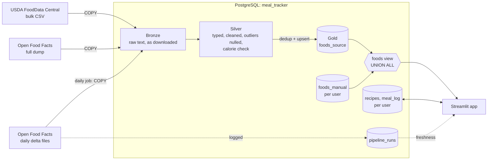

# Calorie & Macro Tracker

A data pipeline with an app on top, not a CRUD app. About 4.7 million foods
from USDA FoodData Central and Open Food Facts are ingested in bulk,
transformed through a bronze → silver → gold medallion architecture written
entirely in SQL, and kept current by a scheduled daily incremental job. A
multi-user Streamlit app reads from the result to log meals, build recipes,
and track daily calories and macros.

The pipeline is the portfolio piece; the app is what makes it usable.

## What it does

- **Search 4.7M foods**, ranked so your own foods and complete, plain-named
  matches come first ("Banana" before "Banana nut muffin").
- **Barcode lookup**: typed or scanned with the camera. Matches across
  UPC-A / EAN-13 / GTIN-14 formats, and falls back to a live Open Food Facts
  lookup for products newer than the local data.
- **Log meals** built from individual foods, or as portions of a saved recipe.
- **Recipes**: create, edit (ingredients, grams, yield) and delete.
- **Edit or delete logged meals**, including moving them to another day.
- **Home and Calendar pages** with daily calorie / protein / carb / fat totals.
- **Manual foods** for anything missing, private to the user who added them.
- **Daily data refresh**: new and changed products from Open Food Facts
  land in the database every morning, with a run log and failure alerts in
  the app's sidebar.

## Architecture



**Medallion layers, all in SQL** (`src/sql/`):

- **Bronze**: raw files loaded with `COPY` exactly as downloaded. All
  columns are `TEXT`, so ingestion never fails on messy data.
- **Silver**: typing and cleaning. Regex-guarded numeric casts, USDA's
  long-format nutrients pivoted, physically impossible values nulled
  (kcal > 900 or any macro > 100 g per 100 g), and a three-way
  `calorie_check` flag comparing stated kcal with 4/4/9 × protein/carbs/fat
  (20% tolerance).
- **Gold**: `foods_source`, deduplicated by barcode (most complete,
  newest row wins; USDA wins collisions with Open Food Facts).

**Python only moves bytes**: download, decompress, `COPY`, run the `.sql`
files, record the run. No transformation logic lives in Python.

### Schema

| Object | Owner | Purpose |
|---|---|---|
| `users` | | Accounts: email + bcrypt-hashed password |
| `foods_source` | pipeline | USDA + Open Food Facts nutrition data, per 100 g, shared |
| `foods_manual` | user | Hand-entered foods, scoped to one user |
| `foods` *(view)* | | `foods_source UNION ALL foods_manual`; every lookup reads this |
| `recipes` / `recipe_items` | user | Saved recipes and their ingredients (grams) |
| `meal_log` / `meal_log_items` | user | Logged meals with a macro snapshot, plus the foods behind ad hoc meals |
| `pipeline_runs` | pipeline | One row per backfill / delta file: status, rows read and changed, errors, how current the data is |

## Daily incremental ingestion

Open Food Facts publishes one delta file per day listing every product that
changed, and keeps the last 14 days. `src/python/off_pipeline.py`, run
daily by a systemd timer, applies every file it hasn't applied yet, oldest
first:

1. Download the file, stream it into the bronze table with `COPY`.
2. Run the silver SQL: parse JSON, cast, null outliers, calorie check.
3. Upsert into `foods_source` with `INSERT … ON CONFLICT (barcode) DO UPDATE`.
4. Record the result in `pipeline_runs`.

Each file is applied in **one transaction**: it lands completely or not at
all, and a failure stops the run so files are never applied out of order.

The upsert follows four rules:

- **Update in place, never rebuild.** `recipe_items` and `meal_log_items`
  reference `foods_source.id`, so the table is never dropped or reloaded;
  existing rows keep their ids.
- **Newest wins.** Each row stores the source's `last_modified_t`; older
  data can never overwrite newer, so replaying or reordering deltas is safe.
- **USDA wins.** Open Food Facts never overwrites a USDA row.
- **Only real changes are written.** Unchanged rows are skipped with
  `IS DISTINCT FROM`, so the row count reflects actual changes.

**Operational details:**

- **Gap detection.** If the machine was off longer than the 14 days of
  delta files, the run is flagged and the app shows a warning; running
  `off_pipeline.py --full` streams the full dump through the same SQL to
  catch up. The full refresh is batched and idempotent, so it can be stopped
  and restarted safely.
- **One run at a time.** A Postgres advisory lock prevents a daily run from
  colliding with a running full refresh.
- **Catch-up after sleep.** The systemd timer uses `Persistent=true` and
  retries on failure.

## Design decisions

- **ELT, not ETL.** Bronze keeps the source exactly as delivered, so any
  transform can be fixed and re-run from SQL without re-downloading.
- **Bulk exports, not the live API, for ingestion.** Both sources ask bulk
  consumers to use exports. The live Open Food Facts API is used only for a
  single user-scanned barcode the local data doesn't have (Open Food Facts'
  rule: one API call per real scan), and the result is saved as the user's
  own food. The app never writes to the pipeline-owned table.
- **Physical separation of pipeline and user data.** Separate tables,
  joined by a `UNION ALL` view. The pipeline can't touch user data by
  construction, not by convention.
- **Macros stored per 100 g, always.** Recipe and daily totals are queries,
  not stored columns.
- **`meal_log` snapshots macros at log time.** Editing a recipe or a food
  later never rewrites history. Changing a recipe meal's portions scales its
  own snapshot, so it stays correct even after the recipe is deleted.
- **Every query is parameterized.** Login and search input is a real trust
  boundary.

### Performance and correctness fixes

- **Generic foods were missing or unusable.** The original USDA load
  passed ~87,000 lab records (sample / sub-sample / acquisition rows, no
  macros) through as if they were foods, and Foundation foods came through
  with no calories because they report energy as Atwater kcal (nutrient
  2047/2048), not 1008. `usda_generic_load.py` loads SR Legacy (Foundation optional)
  with nutrient fallbacks, keyed by USDA's `fdc_id` (they have no barcode),
  and removes the junk rows unless a recipe or meal references them.
  Search now ranks generic foods ("Bananas, raw") ahead of branded ones.

- **One JSON parse per product.** The first version of the silver query let
  Postgres inline a subquery and re-parse each ~15 KB product 14 times.
  Forcing a single parse (`OFFSET 0`) cut a 20,000-product batch from
  21 s to 3 s. Bronze and silver tables are `UNLOGGED`, since they're
  rebuilt every batch.
- **Barcode formats.** The same product appears as 12, 13 or 14 digits
  depending on the source and scanner; lookups match all zero-padded forms.
- **A silver bug found during Phase 8.** The Open Food Facts outlier step
  was a copy of the USDA one, so impossible values were never cleared for
  Open Food Facts rows; fixed, and corrected by the full refresh.

## Project structure

```
src/
  sql/
    bronze/    raw load tables
    silver/    typing, cleaning, outliers, calorie check
    gold/      foods_source, user tables, foods view, OFF upsert
    app/       users, pipeline_runs
  python/
    app.py               Streamlit app
    auth.py              registration / login (bcrypt)
    meal_logging.py      search, ad hoc meals, daily rollup
    meal_editing.py      edit / delete logged meals
    recipes.py           create / edit / delete / log recipes
    manual_foods.py      user-entered foods
    app_queries.py       recipe list, barcode lookup, data freshness
    off_api.py           single-barcode Open Food Facts lookup
    off_pipeline.py      daily delta + full refresh job
    usda_generic_load.py USDA SR Legacy generic foods (one-time, rerunnable)
    test_*.py            test suites
deploy/
  systemd/     off-update.service + .timer (daily job)
  launcher/    desktop icon, start/stop script (auto-closes with the tab)
  check_setup.sh   verifies files, database, schedule, launcher, tests
work_log/      dated notes for every working session
```

## Running it

Requires PostgreSQL 16+ and Python 3.11+.

```bash
git clone https://github.com/tonyy-shin/Calorie-Macro-Tracker.git
cd Calorie-Macro-Tracker
python3 -m venv ~/venv && source ~/venv/bin/activate
pip install -r requirements.txt
createdb meal_tracker
```

Database credentials go in `.streamlit/secrets.toml` (gitignored):

```toml
[db]
dbname = "meal_tracker"
user = "your_user"
# host / password if not using local peer auth
```

Initial load: raw USDA and Open Food Facts exports aren't committed. Run the
`src/sql` files layer by layer (bronze → silver → gold, then `app/`); the
`work_log/` entries document the exact order and verification queries used.
After that, the pipeline maintains itself:

```bash
python src/python/off_pipeline.py --full     # one-time catch-up, streams the full dump
cp deploy/systemd/off-update.* ~/.config/systemd/user/
systemctl --user enable --now off-update.timer

streamlit run src/python/app.py              # or: bash deploy/launcher/install.sh
```

> ⚠️ Never re-run `src/sql/gold/create_foods_source.sql` on a live database.
> It drops and rebuilds the table with new ids, breaking every saved recipe
> and logged meal. Updates go through the upsert only.

## Tests

Eight suites with 250+ checks run against the real database, using
throwaway users and January 1999 dates, and clean up after themselves.
They cover auth-scoped visibility (one user can't see or edit another's
data), no partial writes on failure, snapshot correctness, search ranking,
barcode matching, and the ingestion job end to end with fake delta files:
ids stay stable, USDA isn't overwritten, stale data is ignored, corrupt
files roll back, and gaps are detected.

```bash
bash deploy/check_setup.sh      # checks the whole setup and runs every suite
```

## Status

- ✅ Phase 0: Environment
- ✅ Phase 1: Bronze ingestion (USDA + Open Food Facts)
- ✅ Phase 2: Silver / gold transform, initial backfill (4.7M foods)
- ✅ Phase 3: Users and auth
- ✅ Phase 4: Manual foods and the unified `foods` view
- ✅ Phase 5: Meal logging
- ✅ Phase 6: Recipes
- ✅ Phase 7: Streamlit app
- ✅ Phase 8: Daily incremental ingestion (Open Food Facts)
- ✅ Phase 8b: USDA generic foods (SR Legacy, 7,793 foods), keyed by `fdc_id`
- ⬜ Phase 9: Daily targets, trend charts; monthly USDA refresh

## Data sources and licenses

- [Open Food Facts](https://world.openfoodfacts.org/): data available under
  the [Open Database License](https://opendatacommons.org/licenses/odbl/1-0/);
  contents under the Database Contents License.
- [USDA FoodData Central](https://fdc.nal.usda.gov/): public domain (CC0).

Code: MIT.
